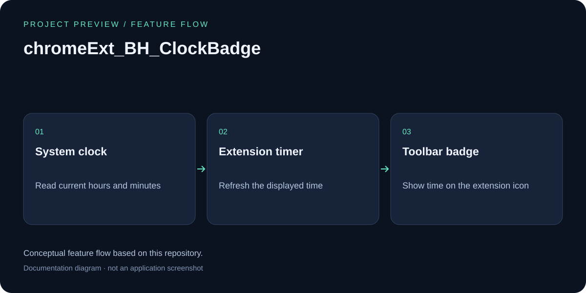
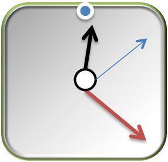

# Clock Badge - Chrome Extension

## Feature overview

Conceptual feature flow based on this repository; this is a documentation diagram, not an application screenshot.

 

**Show me current time**

A simple and elegant Chrome extension that displays the current time as a badge on the browser action icon.

## Description

This Chrome extension shows the current time (hours and minutes) as a badge text on the extension icon in Chrome's toolbar. The time updates automatically every 30 seconds, providing users with a convenient way to check the current time without leaving their browser window.

## Features

- **Real-time Clock Display**: Shows current time in HH:MM format
- **Auto-update**: Refreshes every 30 seconds
- **Clean Interface**: Minimalist design with time displayed as badge text
- **Lightweight**: Simple background script with minimal resource usage
- **Cross-platform**: Works on all platforms that support Chrome extensions

## Installation

### From Source Code

1. Clone or download this repository
2. Open Chrome and navigate to `chrome://extensions/`
3. Enable "Developer mode" in the top right corner
4. Click "Load unpacked" and select the extension directory
5. The Clock Badge extension should now appear in your toolbar

### Manual Installation

1. Download the extension files
2. Open Chrome and go to `chrome://extensions/`
3. Turn on Developer mode
4. Click "Load unpacked extension"
5. Browse to the folder containing the extension files
6. Click "Select Folder"

## How It Works

The extension uses a background script that:

1. **Initializes**: Gets the current time when the extension loads
2. **Updates Regularly**: Uses `setInterval()` to update the time every 30 seconds
3. **Displays Time**: Uses Chrome's `browserAction.setBadgeText()` API to show the time as badge text
4. **Formats Time**: Ensures two-digit format (e.g., "09:05" instead of "9:5")

## Technical Details

### Files Structure

- `manifest.json` - Extension configuration and permissions
- `background.js` - Main logic for time tracking and display
- `background.html` - Background page that loads the script
- `Icon-*.png` - Extension icons in various sizes (16x16, 48x48, 64x64, 128x128)

### Key Functions

- `checkTime()` - Gets current time and updates the badge text
- `scheduleRequest()` - Sets up the 30-second interval timer

### Permissions

- `background` - Required for the background script to run continuously

## Browser Compatibility

- Chrome (Manifest V2)
- Chromium-based browsers

## Version History

- **v1.0.1** - Current version with 30-second update interval

## Development

### Prerequisites

- Google Chrome browser
- Basic knowledge of JavaScript and Chrome Extension APIs

### Local Development

1. Make changes to the source files
2. Go to `chrome://extensions/`
3. Click the refresh icon for the Clock Badge extension
4. Test your changes

## Blog Post

For more details about the development process, check out the original blog post:
[Clock Badge for Chrome - Chrome Extension](http://studiobinghuan.blogspot.tw/2014/04/clock-badge-for-chrome-chrome-extension.html?view=flipcard)

## Contributing

1. Fork the repository
2. Create your feature branch
3. Commit your changes
4. Push to the branch
5. Create a Pull Request

---

*A simple yet useful Chrome extension for keeping track of time while browsing.*